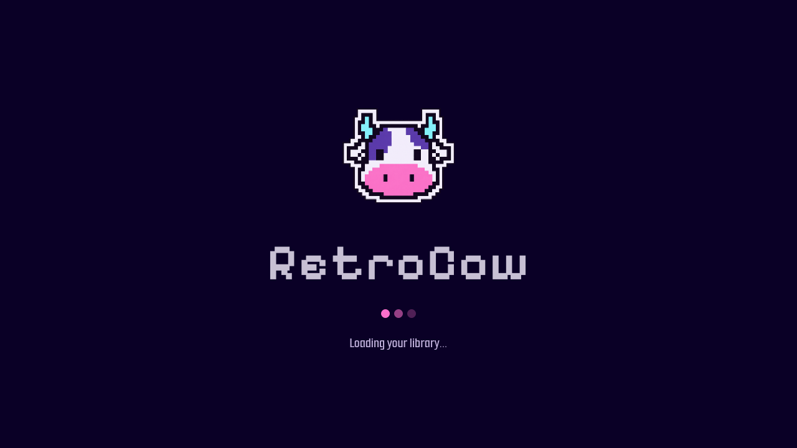
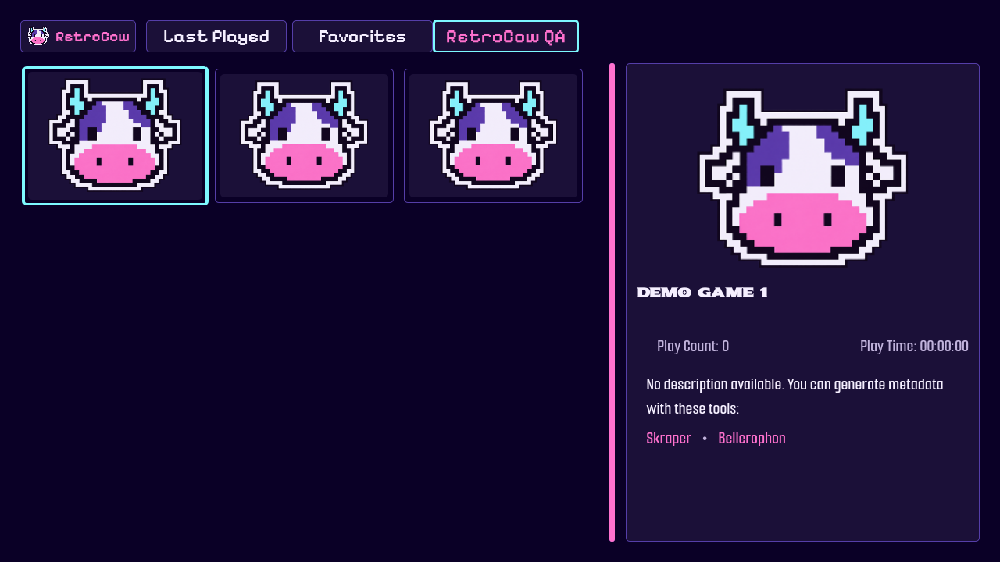
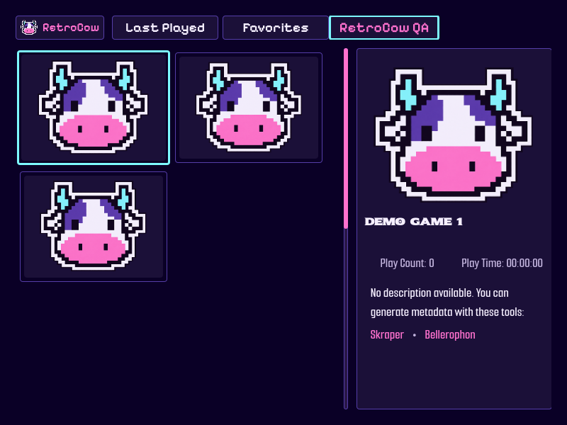

# RetroCow

**RetroCow 0.1.0** es una primera versión de prueba para Pegasus Frontend, basada en **Amberline 1.0.4**, creado por **Gonzalo Abbate / ZagonAb**. Conserva su navegación y estructura, con una vaca pixelada y una paleta vaporwave propia.

## Qué cambia

- Identidad RetroCow en la lista de temas, el splash del tema, la barra de colecciones, la pantalla de lanzamiento, las notificaciones y la confirmación de cierre de sesión de RetroAchievements.
- Vaca transparente en violeta, rosa y cian. El recurso de ejecución mide 256 × 229 píxeles; la imagen suministrada se conserva en `assets/branding/retrocow-source.png`.
- Paleta `retrocow` por defecto, más las 14 paletas originales. La elección se recuerda entre sesiones.
- Actualizaciones vinculadas a las releases de este fork, con numeración independiente de Amberline. No se crean releases ni se instalan actualizaciones automáticamente.

El botón **RetroCow** superior izquierdo abre el selector de colores. Con joystick, ir a la primera colección y pulsar el control de colección anterior. Los controles originales se conservan.

## Instalar para probar

1. Descargar el ZIP de la rama que contiene estos cambios. Mientras el PR esté abierto, usar su **rama de origen**; `Test` recibirá los cambios cuando se integre el PR.
2. Extraer en una carpeta independiente llamada `retrocow`, dentro del directorio `themes` de Pegasus. `theme.cfg` y `theme.qml` deben quedar directamente en `themes/retrocow/`, junto con los QML y `assets/`.
3. Seleccionar **RetroCow** en Ajustes. Mantener Amberline en otra carpeta permite comparar y volver al original.
4. Usar la misma biblioteca, carátulas, videos y configuración que con Amberline. Con teclado, **F5** recarga el tema.

| Plataforma | Carpeta de temas habitual |
| --- | --- |
| Android / TVBox | `<almacenamiento>/Android/data/org.pegasus_frontend.android/files/pegasus-frontend/themes/` |
| Windows | `%LOCALAPPDATA%\pegasus-frontend\themes\` |
| Linux | `~/.config/pegasus-frontend/themes/` |
| Modo portátil | `<carpeta de Pegasus>/config/themes/` |

En Android la ruta accesible puede variar según la versión y los permisos. Usar el mismo directorio donde ya funciona Amberline; Pegasus también documenta ubicaciones alternativas.

RetroCow se aplica cuando no hay una elección de color propia guardada. Sus preferencias de color y actualización usan claves nuevas: una antigua elección `coffee` no reemplaza el nuevo valor inicial. El estado de juegos, colecciones y RetroAchievements mantiene su lógica original. La memoria pertenece a cada tema: instalar en una carpeta nueva no importa automáticamente preferencias anteriores.

## Rendimiento y alcance

Se mantienen los componentes de grilla, tarjetas, búsqueda, orientación, multimedia y sus mecanismos de carga/caché. No se agregan shaders, desenfoques, partículas, videos de fondo, temporizadores ni animaciones a la mascota. Es una imagen estática local, compartida mediante la caché de Qt. El botón de identidad reemplaza el icono de colores; no se añade ningún elemento por tarjeta de juego.

Se conservan el splash mínimo de **700 ms**, sus condiciones de finalización y los tiempos de lanzamiento originales. El botón ocupa algo más de ancho; las colecciones conservan su desplazamiento horizontal.

Esto acota los cambios, pero **no constituye un benchmark ni garantiza FPS equivalentes en una TVBox**. Ver [guía de prueba](docs/TESTING.md) y [decisiones de implementación](docs/IMPLEMENTATION.md).

Este tema cambia su propio splash, después de cargar Pegasus. El logo **P** del arranque de la aplicación pertenece a Pegasus y no se reemplaza mediante este fork.

## Capturas de la prueba de escritorio

Capturas reales de Pegasus con una biblioteca ficticia de tres entradas y renderizado por software. Se usa la vaca como carátula de prueba; no se incluyen juegos ni ROMs. Estas imágenes muestran la identidad y el diseño, no un benchmark de la TVBox.

Ver [validaciones realizadas y sus límites](docs/VALIDATION.md).

## Créditos y licencia

- **Original:** [Amberline](https://github.com/ZagonAb/Amberline), por **Gonzalo Abbate / ZagonAb**. Base 1.0.4, commit `ef3d7404b1ba56a1319e0fc544e51e96d8bf151c`.
- **Adaptación RetroCow:** Varghh. La mascota parte del icono suministrado para el proyecto; la variante de color se preparó con asistencia de generación de imágenes.
- **Frontend:** [Pegasus](https://github.com/mmatyas/pegasus-frontend), por Mátyás Mustoha y colaboradores.
- **Notificación:** [TheArbuzikYT](https://freesound.org/s/840284/), CC0.
- **Otros sonidos e iconos:** colaboradores de [retroarch-assets / libretro](https://github.com/libretro/retroarch-assets), [CC BY 4.0](https://creativecommons.org/licenses/by/4.0/).
- **Fuentes:** avisos y licencias OFL conservados en `assets/fonts/`.

La adaptación conserva **[CC BY-NC-SA 4.0](https://creativecommons.org/licenses/by-nc-sa/4.0/)**, indicada por Amberline: atribución, uso no comercial y compartir bajo la misma licencia. Los recursos de terceros mantienen sus licencias. Ver [LICENSE.md](LICENSE.md) y [README original íntegro](docs/AMBERLINE_UPSTREAM.md).

Apoyo al autor original: [PayPal](https://paypal.me/ZagonAb), [Liberapay](https://liberapay.com/Gonzalo/donate), [Ko-fi](https://ko-fi.com/zagonab).
